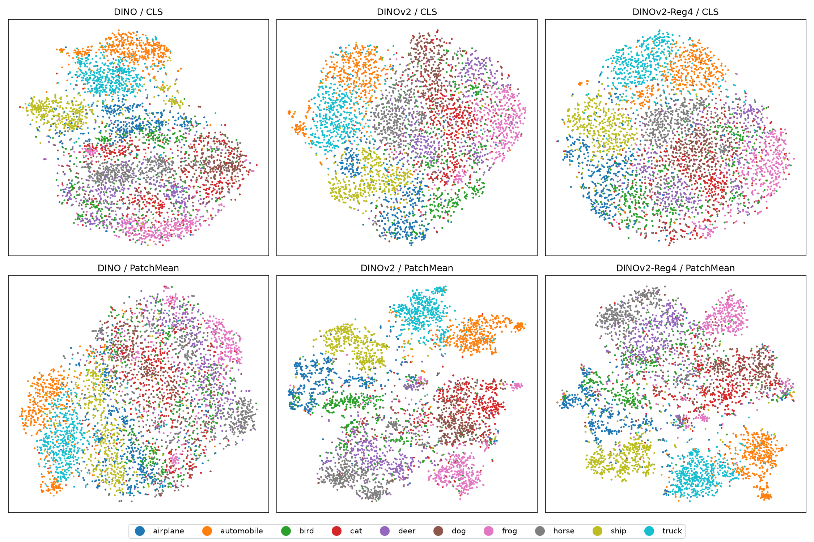
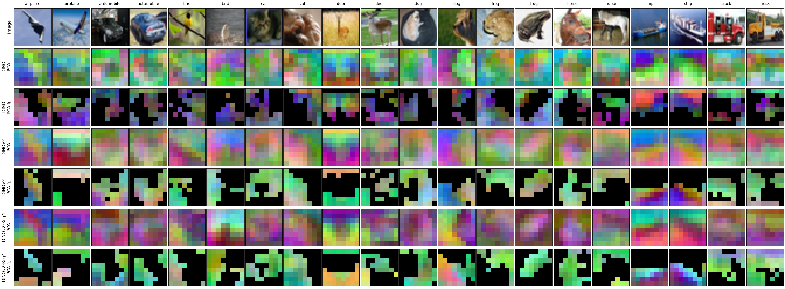

# 01. DINO vs. DINOv2 on CIFAR-10 (ViT-Tiny/4)

- **Status:** done (seed 0, 1000 epochs)

## Goal

Compare DINO and DINOv2 trained from scratch on CIFAR-10 under identical conditions, with the representation quality of the
patch tokens in mind (they are the latent of [rae-cifar](https://github.com/shumpei-takezaki/rae-cifar)).

## Setup

- Data: CIFAR-10 train (50k, labels unused for pretraining); evaluation on test (10k).
- Backbone: ViT-Tiny/4 (width 192, depth 12, 3 heads; 32×32 → 8×8 = 64 patch tokens).
- All runs share `configs/base.yaml`: `mrnghia90` augmentation, global batch 256, AdamW lr 5e-4, 1000 epochs, 10 warmup epochs,
  weight decay 0.04 → 0.4, teacher EMA 0.996 → 1.0, fp32. Only the loss weights and the number of registers differ.

| Run | Config | Loss | Registers |
|---|---|---|---:|
| DINO | `configs/dino.yaml` | DINO | 0 |
| DINOv2 | `configs/dinov2.yaml` | DINO + iBOT (1.0) + KoLeo (0.1) | 0 |
| DINOv2-Reg4 | `configs/dinov2_reg4.yaml` | same as DINOv2 | 4 |

- One seed (0) per run; about 16.5 h each on one A100-40GB (median 56–59 s/epoch).
- Evaluation always uses the EMA teacher backbone. kNN: k = 20, T = 0.07, L2-normalized features. Linear probe: SGD for 100 epochs
  (lr 0.1, cosine) on standardized frozen features, with fixed (untuned) hyperparameters.

## Results

Final top-1 accuracy on CIFAR-10 test (%), 1000 epochs:

| Method | Registers | kNN CLS | kNN PatchMean | Linear CLS | Linear PatchMean |
|---|---:|---:|---:|---:|---:|
| DINO | 0 | 82.04 | 78.27 | 79.86 | 77.74 |
| DINOv2 | 0 | **85.49** | **86.05** | **81.25** | **86.59** |
| DINOv2-Reg4 | 4 | 84.59 | 84.04 | 79.84 | 85.00 |

Lower references with the same kNN protocol: randomly initialized ViT-Tiny/4 30.96 (CLS) / 32.18 (PatchMean); raw pixels
(mean-subtracted) 45.93. For an external reference, solo-learn's CIFAR-10 DINO (ResNet-18, 1000 epochs) reaches 89.52% linear;
the backbone and protocol differ, so it is not directly comparable. Raw numbers: [results.json](../results.json).

kNN during training (CLS / PatchMean):

| Epoch | 100 | 300 | 500 | 700 | 900 | 1000 |
|---|---|---|---|---|---|---|
| DINO | 76.7 / 74.4 | 79.9 / 77.6 | 81.6 / 77.7 | 81.7 / 77.5 | 82.0 / 77.8 | 82.0 / 78.3 |
| DINOv2 | 81.5 / 78.1 | 83.5 / 81.6 | 84.7 / 83.3 | 85.1 / 85.1 | 85.4 / 85.8 | 85.5 / 86.0 |
| DINOv2-Reg4 | 81.6 / 77.8 | 83.4 / 81.6 | 84.4 / 82.7 | 84.7 / 83.1 | 84.7 / 84.0 | 84.6 / 84.0 |

Findings:

1. **DINOv2 beats DINO on every metric.** The gap is largest for the mean patch token (kNN +7.8 pt, linear +8.9 pt), consistent
   with iBOT (predicting masked patches) improving the patch tokens.
2. **They improve differently over time.** DINO plateaus around epoch 500, while the DINOv2 PatchMean kNN is still rising at
   epoch 1000 (+2.7 pt from 500 to 1000).
3. **For DINOv2, PatchMean ≥ CLS** (kNN 86.05 vs. 85.49). For DINO it is the other way round (CLS is 3.8 pt higher).
4. **Reg4 is slightly below DINOv2 without registers** (PatchMean kNN −2.0 pt). With one seed we cannot tell whether this is noise.
5. **For CLS, linear is below kNN** for all three runs (DINOv2: 81.25 vs. 85.49). We attribute this to the fixed, untuned
   linear-probe hyperparameters and treat the CLS linear numbers as provisional.

### Training health

| Run | Epoch | DINO loss | iBOT loss | KoLeo loss | Grad norm (before clipping) | Teacher CLS std |
|---|---:|---:|---:|---:|---:|---:|
| DINO | 1 / 100 / 500 / 1000 | 7.74 / 1.86 / 0.74 / 0.27 | – | – | 1.7 / 1.6 / 4.3 / 10.0 | 0.80 / 0.95 / 2.05 / 2.91 |
| DINOv2 | 1 / 100 / 500 / 1000 | 7.78 / 1.51 / 0.62 / 0.25 | 3.94 / 1.43 / 1.30 / 1.12 | 0.63 / −0.10 / −0.14 / −0.18 | 2.8 / 2.0 / 4.7 / 13.3 | 0.81 / 1.13 / 2.03 / 2.91 |
| DINOv2-Reg4 | 1 / 100 / 500 / 1000 | 7.72 / 1.45 / 0.56 / 0.23 | 3.92 / 1.36 / 1.27 / 1.15 | 0.60 / −0.10 / −0.15 / −0.18 | 5.2 / 2.0 / 4.5 / 12.0 | 0.78 / 1.14 / 2.02 / 2.88 |

- No NaN / Inf in any run. After epoch 10, the epoch-mean total loss never rose by more than 0.014 from one epoch to the next.
- No sign of collapse: the teacher CLS std grows monotonically and the DINO center norm is stable at about 15.
- KoLeo is negative by definition (−log of the nearest-neighbour distance, which exceeds 1).
- The gradient norm before clipping grows in the second half and exceeds the clipping threshold of 3.0 from about epoch 400 on
  (same for all three runs).

### Qualitative analysis

Made with `python -m cifar_dino.analyze` (see the README).



- **t-SNE (5000 test images):** the DINO mean patch tokens mix the classes, except for the vehicles. The DINOv2 and Reg4 mean
  patch tokens form one cluster per class, in line with the kNN gap (78.3 → 86.0). With CLS, all three separate the vehicles
  well while the animals (cat / dog / deer) overlap.



- **Patch PCA:** without preprocessing, 12–14% of the patch variance is explained by position alone and PC1 separates the top of
  the image from the bottom. After subtracting the per-position mean, the PC1 > 0 region ("fg" rows) follows the object shape
  (frog, horse, cat, …) for DINOv2 and Reg4, while DINO gives a patchy foreground. Sky or water is sometimes picked up as
  foreground (ship, deer); at 8×8 resolution this is only indicative.

## Not done yet

- A proper linear-probe protocol (choose lr / weight decay on a validation split of train, not on test).
- Seeds 1 and 2 with mean ± std, needed in particular to settle the Reg4 difference.
- Training DINOv2 for 2000 epochs (the PatchMean kNN was still rising).

## Reproduce

```bash
scripts/train_dino.sh; scripts/train_dinov2.sh; scripts/train_dinov2_reg4.sh   # outputs/<config>/
scripts/eval_dino.sh; scripts/eval_dinov2.sh; scripts/eval_dinov2_reg4.sh
uv run python -m cifar_dino.analyze outputs/{dino,dinov2,dinov2_reg4}/teacher_backbone.pt --out-dir outputs/analysis
```
